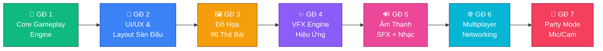
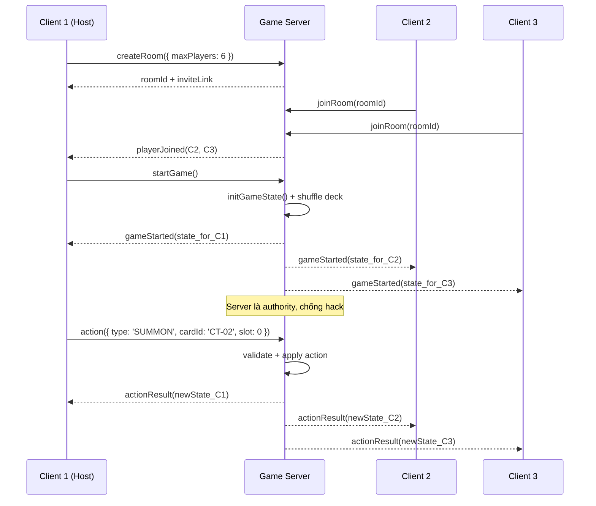
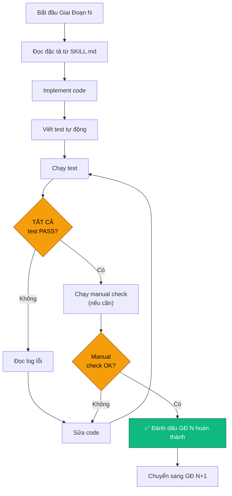

# 🎮 GAME MASTER GUIDE — ĐẤU TRƯỜNG XÓM BẤT ỔN

## Hướng Dẫn AI Agent Thực Hiện & Tự Kiểm Tra Toàn Bộ Quá Trình Phát Triển Game

> [!IMPORTANT]
> File này là **bản đồ tổng thể (Master Blueprint)** cho AI Agent.
> Agent PHẢI đọc kỹ file này trước khi bắt tay vào bất kỳ giai đoạn nào.
> Mọi quyết định thiết kế, kiến trúc code, và kiểm thử đều phải tham chiếu về đây.

---

## MỤC LỤC

1. [Tổng Quan Dự Án](#1-tổng-quan-dự-án)
2. [Kiến Trúc Kỹ Thuật](#2-kiến-trúc-kỹ-thuật)
3. [Giai Đoạn 1 — Core Gameplay Engine](#3-giai-đoạn-1--core-gameplay-engine)
4. [Giai Đoạn 2 — UI/UX & Bố Cục Sàn Đấu](#4-giai-đoạn-2--uiux--bố-cục-sàn-đấu)
5. [Giai Đoạn 3 — Đồ Họa Thẻ Bài 96/96](#5-giai-đoạn-3--đồ-họa-thẻ-bài-9696)
6. [Giai Đoạn 4 — VFX Engine & Hiệu Ứng Sàn Đấu](#6-giai-đoạn-4--vfx-engine--hiệu-ứng-sàn-đấu)
7. [Giai Đoạn 5 — Hệ Thống Âm Thanh](#7-giai-đoạn-5--hệ-thống-âm-thanh)
8. [Giai Đoạn 6 — Multiplayer & Networking](#8-giai-đoạn-6--multiplayer--networking)
9. [Giai Đoạn 7 — Party Mode (Mic/Cam)](#9-giai-đoạn-7--party-mode-miccam)
10. [Quy Trình Tự Kiểm Tra Từng Giai Đoạn](#10-quy-trình-tự-kiểm-tra-từng-giai-đoạn)
11. [Checklist Nghiệm Thu Tổng Thể](#11-checklist-nghiệm-thu-tổng-thể)
12. [Phụ Lục — Tham Chiếu File Dữ Liệu](#12-phụ-lục--tham-chiếu-file-dữ-liệu)

---

## 1. TỔNG QUAN DỰ ÁN

### 1.1. Thông Tin Game

| Thuộc tính | Giá trị |
|:---|:---|
| **Tên game** | Đấu Trường Xóm Bất Ổn |
| **Thể loại** | Strategic Card Game (TCG-style) — Multiplayer Online Real-time |
| **Nền tảng** | Web App (HTML/CSS/JS) — chơi trực tiếp trên trình duyệt |
| **Số người chơi** | 2 đến 6 người chơi online |
| **Chế độ chơi** | Multiplayer Online thời gian thực (tạo phòng, mời bạn bè qua link) |
| **Phong cách đồ họa** | Vietnamese Urban Pop-Art — xóm trọ, đèn đường, mái tôn, quán trà đá |
| **Âm thanh** | Đầy đủ: Nhạc nền + SFX từng hành động + giọng hô chiêu |
| **Tương tác đời thực** | Toggle Party Mode (mic/cam) / Chill Mode (tự động hóa) |
| **Bộ bài** | 96 mã thẻ độc bản — 144 lá bài vật lý (bản in) |

### 1.2. File Dữ Liệu Tham Chiếu

Agent PHẢI đọc các file sau trước khi bắt đầu:

| File | Đường dẫn | Nội dung |
|:---|:---|:---|
| **Dữ liệu thẻ bài & Luật chơi** | `dau_truong_xom_bat_on_full_cards.md` | 96 mã thẻ, luật chơi chi tiết 4 giai đoạn, combo mẫu |
| **Workflow VFX & Đồ họa** | `antigravity_vfx_card_workflow.md` | Kiến trúc sàn đấu, pipeline đồ họa 96 thẻ, VFX matrix |
| **SKILL upgrade-card-art-and-vfx** | `.agent/skills/upgrade-card-art-and-vfx/SKILL.md` | Skill chi tiết cho giai đoạn đồ họa & VFX |

### 1.3. Thứ Tự Ưu Tiên Phát Triển



> [!NOTE]
> Mỗi giai đoạn phải ĐẠT kiểm thử (xem Mục 10) trước khi chuyển sang giai đoạn tiếp theo.
> Agent được phép quay lại sửa giai đoạn trước nếu phát hiện lỗi khi test giai đoạn sau.

---

## 2. KIẾN TRÚC KỸ THUẬT

### 2.1. Tech Stack Bắt Buộc

| Tầng | Công nghệ | Lý do |
|:---|:---|:---|
| **Frontend** | Vanilla JS (ES Modules) + HTML5 + CSS3 | Nhẹ, nhanh, không cần bundler phức tạp cho MVP |
| **State Management** | Custom EventBus + Immutable State | Game state phải deterministic cho multiplayer sync |
| **Animation** | Web Animations API + CSS Transforms + Canvas 2D | 60FPS VFX trực tiếp trên DOM, canvas cho particles |
| **Networking** | WebSocket (Socket.IO hoặc ws) | Real-time bidirectional cho multiplayer |
| **Backend** | Node.js + Express | Lightweight game server, room management |
| **Deployment** | Vercel / Netlify (frontend) + Railway / Render (backend) | Miễn phí cho MVP |

### 2.2. Cấu Trúc Thư Mục Dự Án

```
GameTB/
├── src/
│   ├── core/                    # ← GĐ 1: Game Engine Core
│   │   ├── GameState.js         # Trạng thái game bất biến (immutable state)
│   │   ├── GameEngine.js        # Bộ máy xử lý luật chơi chính
│   │   ├── TurnManager.js       # Quản lý 4 giai đoạn mỗi lượt
│   │   ├── BattleResolver.js    # Xử lý giao tranh & sát thương
│   │   ├── CardEffectRegistry.js# Đăng ký hiệu ứng 96 thẻ bài
│   │   ├── CardEffects/         # Hiệu ứng riêng từng thẻ
│   │   │   ├── CT_effects.js    # Chiến Thần Cấp Thấp (CT-01 → CT-24)
│   │   │   ├── TR_effects.js    # Trùm Khu Phố (TR-01 → TR-12)
│   │   │   ├── DH_effects.js    # Dung Hợp Huyền Thoại (DH-01 → DH-08)
│   │   │   ├── DC_effects.js    # Đạo Cụ (DC-01 → DC-10)
│   │   │   ├── DR_effects.js    # Drama (DR-01 → DR-14)
│   │   │   ├── NQ_effects.js    # Nghiệp Quật (NQ-01 → NQ-16)
│   │   │   ├── NV_effects.js    # Nhân Vật Đại Diện (NV-01 → NV-06)
│   │   │   └── AQ_effects.js    # Ám Quẻ (AQ-01 → AQ-06)
│   │   ├── ChainResolver.js     # Xử lý chuỗi phản đòn (Chain Link)
│   │   ├── FusionSystem.js      # Hệ thống Dung Hợp
│   │   ├── GhostSystem.js       # Hệ thống Hồn Ma Báo Oán
│   │   └── DeckBuilder.js       # Xáo bài, chia bài, tái chế Bãi Rác
│   │
│   ├── data/                    # ← Dữ liệu tĩnh
│   │   ├── cards.js             # Tất cả 96 mã thẻ (id, tên, hệ, stats, mô tả)
│   │   ├── cardImages.js        # Map mã thẻ → URL/SVG hình ảnh
│   │   └── soundMap.js          # Map hành động → file âm thanh
│   │
│   ├── ui/                      # ← GĐ 2: Giao diện
│   │   ├── ArenaLayout.js       # Bố cục bàn chơi 2-6 người (spatial zones)
│   │   ├── CardComponent.js     # Component thẻ bài 2.5D (5 lớp)
│   │   ├── PlayerBoard.js       # Bảng điều khiển cá nhân
│   │   ├── HandDisplay.js       # Hiển thị bài trên tay
│   │   ├── HPCounter.js         # Thanh Điểm Nhân Phẩm
│   │   ├── GraveyardViewer.js   # Xem Bãi Rác
│   │   ├── FusionDeckPanel.js   # Hiển thị Chồng Bài Huyền Thoại
│   │   ├── TurnIndicator.js     # Hiển thị giai đoạn hiện tại
│   │   ├── ActionMenu.js        # Menu hành động (triệu hồi, tấn công, úp bẫy...)
│   │   ├── TargetSelector.js    # Chọn mục tiêu tấn công / kích hoạt
│   │   ├── ChatBox.js           # Chat trong phòng chơi
│   │   └── GameLog.js           # Lịch sử hành động
│   │
│   ├── engine/                  # ← GĐ 4: VFX & Animation Engine
│   │   ├── ActionSequencer.js   # Hàng đợi bất đồng bộ xử lý hành động
│   │   ├── SpatialBoardAnimator.js # Bay bài giữa các tọa độ sàn đấu
│   │   ├── CanvasVFXEngine.js   # Canvas 2D particle system
│   │   ├── VFXPresets.js        # Preset hiệu ứng cho từng nhóm thẻ
│   │   └── ScreenShake.js       # Rung màn hình khi va chạm
│   │
│   ├── audio/                   # ← GĐ 5: Âm thanh
│   │   ├── AudioManager.js      # Quản lý phát nhạc/SFX
│   │   ├── MusicPlayer.js       # Nhạc nền ambient
│   │   └── VoiceCallout.js      # Giọng hô chiêu khi kích hoạt thẻ
│   │
│   ├── net/                     # ← GĐ 6: Multiplayer
│   │   ├── RoomManager.js       # Tạo/tham gia/rời phòng
│   │   ├── GameSync.js          # Đồng bộ state giữa các client
│   │   ├── ActionRelay.js       # Gửi/nhận hành động qua WebSocket
│   │   └── ReconnectHandler.js  # Xử lý mất kết nối & reconnect
│   │
│   ├── party/                   # ← GĐ 7: Party Mode
│   │   ├── PartyModeToggle.js   # Toggle Party/Chill mode
│   │   ├── MicDetector.js       # Phát hiện tiếng sủa, hát, hô to
│   │   ├── CamDetector.js       # Phát hiện nhìn chằm chằm (nếu có)
│   │   └── VotingSystem.js      # Hệ thống bỏ phiếu (DR-11)
│   │
│   ├── utils/                   # ← Tiện ích chung
│   │   ├── EventBus.js          # Pub/Sub event system
│   │   ├── RandomUtils.js       # Xáo bài, tung đồng xu
│   │   └── DOMUtils.js          # Helper thao tác DOM
│   │
│   └── index.js                 # Entry point
│
├── server/                      # ← Backend
│   ├── index.js                 # Express + WebSocket server
│   ├── GameRoom.js              # Quản lý phòng chơi server-side
│   ├── ServerGameEngine.js      # Game engine authority (chống hack)
│   └── PlayerSession.js         # Session người chơi
│
├── public/
│   ├── index.html               # Trang chính
│   ├── styles/
│   │   ├── arena.css            # Style bàn chơi
│   │   ├── cards.css            # Style thẻ bài 2.5D
│   │   ├── vfx.css              # Animation keyframes
│   │   └── theme.css            # Biến CSS chủ đề Vietnamese Pop-Art
│   ├── assets/
│   │   ├── cards/               # 96 hình ảnh thẻ bài
│   │   ├── sfx/                 # File âm thanh SFX
│   │   ├── music/               # File nhạc nền
│   │   ├── voices/              # File giọng hô chiêu
│   │   └── ui/                  # Icon, nút, khung viền
│   └── favicon.ico
│
├── tests/                       # ← Kiểm thử tự động
│   ├── core/
│   │   ├── GameEngine.test.js
│   │   ├── BattleResolver.test.js
│   │   ├── CardEffects.test.js  # Test hiệu ứng từng thẻ (96 test cases)
│   │   ├── ChainResolver.test.js
│   │   ├── FusionSystem.test.js
│   │   ├── GhostSystem.test.js
│   │   └── TurnFlow.test.js
│   ├── integration/
│   │   ├── FullGameFlow.test.js # Test cả ván đấu từ đầu đến hết
│   │   └── ComboScenarios.test.js # Test 4 combo bẩn bựa kinh điển
│   └── checklist/
│       └── VerificationRunner.js # Script kiểm tra tự động toàn bộ
│
├── dau_truong_xom_bat_on_full_cards.md  # Dữ liệu gốc
├── antigravity_vfx_card_workflow.md     # Workflow VFX gốc
├── package.json
└── README.md
```

---

## 3. GIAI ĐOẠN 1 — CORE GAMEPLAY ENGINE

> [!IMPORTANT]
> Đây là giai đoạn quan trọng nhất. Nếu logic sai, mọi thứ sau đó vô nghĩa.
> Agent PHẢI implement đúng 100% luật chơi từ file `dau_truong_xom_bat_on_full_cards.md`.

### 3.1. GameState — Cấu Trúc Trạng Thái Game

Agent phải thiết kế GameState bất biến (immutable) để hỗ trợ replay, undo, và đồng bộ multiplayer:

```javascript
// Cấu trúc GameState mẫu — Agent phải implement đầy đủ
const GameState = {
  gameId: 'string',
  phase: 'SETUP' | 'PLAYING' | 'ENDED',
  currentTurn: {
    playerId: 'string',
    phase: 'DRAW' | 'MAIN' | 'BATTLE' | 'END',
    normalSummonUsed: false,       // Đã triệu hồi thường chưa
    actionsThisTurn: [],           // Log hành động trong lượt
  },
  turnOrder: ['p1', 'p2', ...],   // Thứ tự lượt
  roundNumber: 1,                  // Số vòng (để track NV-06 "1 lần mỗi vòng")

  players: {
    'playerId': {
      id: 'string',
      name: 'string',
      representativeCard: 'NV-01', // Thẻ Đại Diện
      hp: 10,                      // Điểm Nhân Phẩm (0 = Hồn Ma)
      isGhost: false,              // Đã thành Hồn Ma chưa
      isEliminated: false,         // Hồn Ma vẫn chơi, không bị loại
      hand: ['card-uuid-1', ...],  // Bài trên tay (tối đa 6, NV-05 = 7)
      monsterSlots: [null, null],  // 2 Ô Chiến Thần (CT-23 chiếm cả 2)
      trapSlots: [null, null],     // 2 Ô Nghiệp Quật (NV-04 = 3 ô)
      trapSlotCount: 2,            // Số ô bẫy tối đa (NV-04 = 3)
      handLimit: 6,                // Giới hạn bài trên tay (NV-05 = 7)
      equippedItems: {},           // Đạo Cụ gắn trên từng Chiến Thần
    }
  },

  drawPile: ['card-uuid-1', ...],   // Chồng bài bốc (124 lá bài chính)
  graveyard: ['card-uuid-1', ...],  // Bãi Rác
  fusionDeck: ['DH-01', ...],       // Chồng Bài Huyền Thoại (8 lá, ngửa)
  curseDeck: ['AQ-01', ...],        // Chồng Bài Ám Quẻ (6 lá, úp)

  chainStack: [],                    // Chuỗi phản đòn đang xử lý
  pendingEffects: [],                // Hiệu ứng chờ resolve
};
```

### 3.2. TurnManager — 4 Giai Đoạn Mỗi Lượt

Agent PHẢI implement đúng thứ tự 4 giai đoạn:

#### Giai đoạn 1 — Hóng Hớt (Bốc Bài / DRAW Phase)
- [ ] Bốc 1 lá từ chồng bài chung
- [ ] **Cơ chế chống thọt:** Nếu sân trống (0 Chiến Thần), bốc 2 lá thay vì 1
- [ ] Nếu chồng bài hết → xáo trộn Bãi Rác thành chồng bài mới
- [ ] Hồn Ma: Rút 1 lá Bài Ám Quẻ, đọc hiệu ứng, trả lại đáy chồng

#### Giai đoạn 2 — Bày Trò (Chính / MAIN Phase)
- [ ] Triệu hồi thường: Tối đa 1 Chiến Thần Cấp Thấp/lượt lên ô trống
- [ ] Triệu hồi Hiến Tế: Bỏ 1 Chiến Thần trên sân → gọi 1 Trùm Khu Phố từ tay
- [ ] Triệu hồi Dung Hợp: Bỏ 2 nguyên liệu (sân/tay) → lấy thẻ Dung Hợp từ Chồng Huyền Thoại (KHÔNG tính vào giới hạn triệu hồi thường)
- [ ] Sử dụng Bài Drama: Không giới hạn số lượng
- [ ] Gắn Bài Đạo Cụ: Lên Chiến Thần mình (buff) hoặc đối thủ (debuff), tối đa 2/Chiến Thần
- [ ] Úp Bài Nghiệp Quật: Vào ô Bẫy (tối đa 2, NV-04 = 3)

#### Giai đoạn 3 — Hỗn Chiến (Tấn Công / BATTLE Phase)
- [ ] Mỗi Chiến Thần được tấn công 1 lần/lượt vào bất kỳ người chơi nào
- [ ] Khi đối thủ có Chiến Thần: So sánh Độ Chiến
  - Bên lớn hơn thắng → tiêu diệt bên thua + trừ chênh lệch Nhân Phẩm
  - Bằng nhau → cả hai vào Bãi Rác, không ai mất Nhân Phẩm
- [ ] Khi đối thủ trống sân: Đánh trực diện → trừ Nhân Phẩm = Độ Chiến (tối đa 3)
- [ ] **Giới hạn bảo hộ:** Đánh trực diện tối đa trừ 3 Nhân Phẩm/đòn
- [ ] Kích hoạt Bài Nghiệp Quật khi đủ điều kiện (xem Chain Resolver)

#### Giai đoạn 4 — Xả Rác (Kết Thúc Lượt / END Phase)
- [ ] Kiểm tra giới hạn bài trên tay: Tối đa 6 lá (NV-05 = 7)
- [ ] Người chơi tự chọn bỏ bài thừa vào Bãi Rác
- [ ] Kiểm tra hiệu ứng "cuối lượt" (TR-12 Bà Hỏa: -1 Độ Chiến)

### 3.3. ChainResolver — Chuỗi Phản Đòn

Agent PHẢI implement chuỗi phản đòn kiểu Yu-Gi-Oh Chain Link:

```
Quy tắc:
1. Bài Nghiệp Quật mới úp TRONG lượt này → KHÔNG được lật trong lượt đó
2. Khi hành động thỏa điều kiện → người chơi được hô tên & lật bài
3. Nếu nhiều người cùng muốn lật → "Lá nào lật SAU CÙNG phát huy tác dụng TRƯỚC"
4. Giải quyết chain từ trên xuống dưới (Last In, First Out)
```

### 3.4. CardEffectRegistry — Đăng Ký 96 Hiệu Ứng Thẻ

Agent PHẢI implement hiệu ứng cho TỪNG thẻ bài. Dưới đây là bảng phân loại:

#### A. Hiệu ứng khi triệu hồi (On-Summon)
| Mã | Tên | Hiệu ứng tóm tắt |
|:---|:---|:---|
| CT-01 | Camera Chạy Bằng Cơm | Ép người bên trái ngửa hết bài trên tay 10 giây |
| CT-07 | Cô Bán Xôi Sáng | Bốc ngay 1 lá |
| CT-08 | Thanh Niên Mượn Bật Lửa | Cướp 1 Đạo Cụ đối thủ gắn cho mình |
| CT-16 | Ông Chú Câu Cá | Lấy 1 Đạo Cụ từ Bãi Rác |
| CT-17 | Thợ Sửa Ống Nước | Hủy 1 bẫy úp đối thủ nếu đoán đúng loại |
| CT-20 | Gà Trống 3 Giờ Sáng | Buộc mọi Chiến Thần "ngủ" phải tấn công lượt sau |
| TR-03 | Trùm Phường Đội | Quét sạch Đạo Cụ mọi người khác |
| TR-05 | Pháp Sư Cúng Sao | +2 HP cho bạn + lấy 1 Bẫy từ Bãi Rác úp |
| DH-01 | Tứ Đại Bà Tám | Xem bài 2 người + cướp 1 lá đẹp nhất |
| DH-06 | Bà Trùm BĐS | Cướp 1 Chiến Thần Cấp Thấp đối thủ |
| DH-07 | Liên Minh Hàng Xóm | +3 HP cho bạn, -2 HP người bị lấy nguyên liệu |

#### B. Hiệu ứng khi tấn công (On-Attack)
| Mã | Tên | Hiệu ứng tóm tắt |
|:---|:---|:---|
| CT-02 | Chó Cỏ Đầu Đàn | Sủa "Gâu!" → +2 Độ Chiến (Party Mode: mic detect) |
| CT-03 | Shipper Giao Nhầm | Oẳn tù tì: Thắng → bypass Chiến Thần đánh thẳng HP |
| CT-13 | Chị Đẹp Bán Hàng Online | Hô "Chốt đơn!" + bỏ 1 bài → ép đối thủ bỏ 1 bài |
| CT-15 | Tổ Đội Xe Đạp Điện | Xuyên qua "Cấm tấn công" |
| TR-02 | Chiến Thần Loa Kẹo Kéo | Hát 1 câu → vô hiệu hóa bẫy mục tiêu |
| TR-04 | Thánh Đòi Nợ Thuê | Tấn công 2 lần/lượt vào 2 người khác nhau |
| DH-02 | Thần Chó 3 Đầu | Sủa 3 tiếng → đánh lan 2 người cùng lúc |
| DH-04 | Quái Xế Bốc Đầu | Bypass Chiến Thần, đánh thẳng HP |

#### C. Hiệu ứng thụ động/liên tục (Passive/Continuous)
| Mã | Tên | Hiệu ứng tóm tắt |
|:---|:---|:---|
| CT-05 | Bé Tập Đánh Đàn | Cấm dùng Drama hồi HP |
| CT-06 | Anh Trai Tập Gym | +1 Độ Chiến nếu không có bẫy úp |
| CT-09 | Mèo Hoang | Miễn nhiễm Drama đối thủ. Chết → quay tay (1 lần) |
| CT-10 | Bác Bảo Vệ | Không tấn công được, +2 Độ Chiến khi đỡ đòn |
| CT-11 | Thánh Xin Pass Wifi | Người bên phải bốc ngoài draw phase → bạn cũng bốc 1 |
| CT-12 | Cậu Vàng | +1 Độ Chiến nếu có quân hệ Quậy Phá trên bàn |
| CT-14 | Sinh Viên Cuối Tháng | +3 Độ Chiến nếu HP thấp nhất bàn |
| CT-21 | Thánh Gõ Phím | +1 sát thương cho mọi Bài Drama gây sát thương |
| CT-23 | Chuyên Gia Giữ Chỗ | Chiếm 2 ô, mọi sát thương vượt trội = 0 |
| TR-08 | Trùm Đầu Gấu | Bắt đối thủ phải đánh quân này trước |
| TR-11 | Hacker Đánh Sập Mạng | Cấm nhìn/lật bẫy trong Main Phase |
| DH-03 | Cỗ Máy Karaoke | Miễn nhiễm Drama. Đầu lượt: mọi đối thủ bỏ 1 bài hoặc -1 HP |

#### D. Hiệu ứng khi bị tiêu diệt (On-Destroy)
| Mã | Tên | Hiệu ứng tóm tắt |
|:---|:---|:---|
| CT-04 | Thánh Ăn Vạ | Kẻ giết phải đưa 1 bài ngẫu nhiên trên tay |
| CT-19 | Thanh Niên Sống Ảo | Khi tiêu diệt đối thủ → +1 HP |
| TR-06 | Bà Hàng Thịt | Khi tiêu diệt Chiến Thần → +1 sát thương xuyên giáp |
| TR-07 | Chủ Tịch Giả Nghèo | Khi bị tiêu diệt → triệu hồi miễn phí 1 Cấp Thấp |
| TR-12 | Bà Hỏa | Cuối lượt -1 Độ Chiến. Về 2 hoặc bị tiêu diệt → -2 HP mọi người có quân trên sân |
| DH-05 | Chí Phèo 4.0 | Khi nhận sát thương/bị tiêu diệt → kẻ gây ra chịu GẤP ĐÔI sát thương HP |

#### E. Hiệu ứng đầu lượt (Start of Turn)
| Mã | Tên | Hiệu ứng tóm tắt |
|:---|:---|:---|
| TR-01 | Bà Chủ Trọ Tăng Giá Điện | Mọi người nộp 1 bài (bạn nhận tối đa 2) hoặc -1 HP |
| DH-03 | Cỗ Máy Karaoke | Mỗi đối thủ: bỏ 1 bài hoặc -1 HP |
| NV-01→NV-06 | Nội tại Đại Diện | Mỗi thẻ đại diện có nội tại riêng |

### 3.5. FusionSystem — Dung Hợp Huyền Thoại

Implement đúng 8 công thức Dung Hợp:

| Mã | Công thức | Lưu ý |
|:---|:---|:---|
| DH-01 | 2 quân hệ **Hóng Hớt** bất kỳ | Trên sân hoặc trên tay |
| DH-02 | CT-02 (Chó Cỏ) + CT-12 (Cậu Vàng) | Cụ thể 2 quân |
| DH-03 | 1 quân hệ **Quậy Phá** + 1 **Đạo Cụ** bất kỳ | Đạo Cụ là bài, không phải Chiến Thần |
| DH-04 | 2 quân hệ **Tốc Độ** bất kỳ | Trên sân hoặc trên tay |
| DH-05 | 2 quân hệ **Ăn Vạ** bất kỳ | Trên sân hoặc trên tay |
| DH-06 | TR-01 (Bà Chủ Trọ) + 1 **Chiến Thần** bất kỳ | TR-01 phải là 1 trong 2 nguyên liệu |
| DH-07 | 1 Chiến Thần **của bạn** + 1 Chiến Thần **vừa cướp từ đối thủ** | Flag `wasStolen` trên card |
| DH-08 | CT-03 (Shipper) + CT-13 (Chị Đẹp Online) | Cụ thể 2 quân |

### 3.6. GhostSystem — Hồn Ma Báo Oán

Khi HP về 0:
1. Lật Thẻ Đại Diện sang mặt Hồn Ma → kích hoạt kỹ năng Hồn Ma
2. Thu hồi mọi bài trên sân/tay vào Bãi Rác
3. Mỗi đầu lượt Hồn Ma: Rút 1 lá Bài Ám Quẻ (AQ-01→AQ-06), thực hiện, trả đáy
4. Hồn Ma KHÔNG bị loại khỏi game, vẫn tham gia quấy rối

### 3.7. Kiểm Tra Giai Đoạn 1

> [!CAUTION]
> Agent KHÔNG ĐƯỢC chuyển sang Giai Đoạn 2 nếu chưa pass TẤT CẢ test dưới đây.

```
□ TEST-1.01: Setup đúng — 6 thẻ đại diện, 124 lá chính, 8 lá Dung Hợp, 6 lá Ám Quẻ
□ TEST-1.02: Chia bài — Mỗi người nhận đúng 5 lá
□ TEST-1.03: Bốc bài thường — 1 lá/lượt
□ TEST-1.04: Cơ chế chống thọt — Bốc 2 lá nếu sân trống
□ TEST-1.05: Tái chế Bãi Rác — Xáo trộn khi chồng bài hết
□ TEST-1.06: Triệu hồi thường — Chỉ 1 Cấp Thấp/lượt, phải có ô trống
□ TEST-1.07: Hiến Tế — Bỏ 1 quân sân → gọi Trùm từ tay
□ TEST-1.08: Dung Hợp — Đúng công thức, không tính triệu hồi thường
□ TEST-1.09: Giao tranh — So sánh Độ Chiến, tính sát thương chênh lệch
□ TEST-1.10: Bằng Độ Chiến — Cả hai vào Bãi Rác, không mất HP
□ TEST-1.11: Đánh trực diện — Trừ HP = Độ Chiến, tối đa 3/đòn
□ TEST-1.12: Giới hạn bài cuối lượt — 6 lá (NV-05 = 7)
□ TEST-1.13: Chain Link — Lá lật sau → resolve trước (LIFO)
□ TEST-1.14: Bẫy mới úp — Không được lật trong lượt đặt
□ TEST-1.15: Hồn Ma — HP = 0 → lật thẻ, rút Ám Quẻ mỗi lượt
□ TEST-1.16: Nội tại 6 Đại Diện — Mỗi NV-01→06 hoạt động đúng
□ TEST-1.17: Hiệu ứng 24 Chiến Thần Cấp Thấp — Test từng CT-01→24
□ TEST-1.18: Hiệu ứng 12 Trùm Khu Phố — Test từng TR-01→12
□ TEST-1.19: Hiệu ứng 8 Dung Hợp — Test từng DH-01→08
□ TEST-1.20: Hiệu ứng 10 Đạo Cụ — Test từng DC-01→10
□ TEST-1.21: Hiệu ứng 14 Drama — Test từng DR-01→14
□ TEST-1.22: Hiệu ứng 16 Nghiệp Quật — Test từng NQ-01→16
□ TEST-1.23: Hiệu ứng 6 Ám Quẻ — Test từng AQ-01→06
□ TEST-1.24: Combo 1 "Tặng Quà Tử Thần" — DC-07/DC-04 + DR-02
□ TEST-1.25: Combo 2 "Ngư Ông Đắc Lợi" — NQ-10/NQ-02 + DR-01
□ TEST-1.26: Combo 3 "Bẫy Tâm Lý" — NQ-03/NQ-11 + hành động dụ
□ TEST-1.27: Combo 4 "Mượn Gà Đẻ Trứng" — DR-06 + DH-07
□ TEST-1.28: Win Condition — Người chơi cuối cùng còn HP > 0 thắng
□ TEST-1.29: Đạo Cụ khi Chiến Thần chết — Đạo Cụ đi theo vào Bãi Rác
□ TEST-1.30: CT-23 chiếm 2 ô — Không thể triệu hồi quân khác
```

---

## 4. GIAI ĐOẠN 2 — UI/UX & BỐ CỤC SÀN ĐẤU

### 4.1. Layout Bàn Chơi Đa Người (2-6 Players)

Agent phải thiết kế layout responsive cho 2→6 người chơi:

```
┌─────────────────────────────────────────────────┐
│                  NGƯỜI CHƠI 4                    │
│  [Bẫy1][Bẫy2]  [QuânA][QuânB]  ♥HP  Tay:▓▓▓   │
├───────────┬─────────────────┬───────────────────┤
│  NC 3     │                 │    NC 5           │
│ [B1][B2]  │   ┌─────────┐  │  [B1][B2]         │
│ [QA][QB]  │   │ Bài Bốc │  │  [QA][QB]         │
│ ♥HP Tay   │   │ Bãi Rác │  │  ♥HP Tay          │
│           │   │ Huyền T │  │                    │
├───────────┤   │ Ám Quẻ  │  ├────────────────────┤
│  NC 2     │   └─────────┘  │    NC 6            │
│ [B1][B2]  │                │  [B1][B2]           │
│ [QA][QB]  │                │  [QA][QB]           │
│ ♥HP Tay   │                │  ♥HP Tay            │
├───────────┴─────────────────┴────────────────────┤
│                  BẠN (NC 1)                       │
│   Tay: [🃏][🃏][🃏][🃏][🃏]                       │
│   [QuânA][QuânB]  [Bẫy1][Bẫy2]  ♥♥♥♥♥♥♥♥♥♥ HP  │
└──────────────────────────────────────────────────┘
```

### 4.2. Spatial Zone Registry

Mọi vùng phải gắn `data-zone-id` theo chuẩn:

| Vùng | Format `data-zone-id` |
|:---|:---|
| Chồng Bài Bốc | `zone-draw-pile` |
| Bãi Rác | `zone-graveyard` |
| Chồng Huyền Thoại | `zone-fusion-deck` |
| Chồng Ám Quẻ | `zone-amque-deck` |
| Tay người chơi p | `zone-player-${p}-hand` |
| Ô Chiến Thần s của p | `zone-player-${p}-monster-${s}` |
| Ô Bẫy s của p | `zone-player-${p}-trap-${s}` |
| HP người chơi p | `zone-player-${p}-hp` |

### 4.3. Phong Cách Vietnamese Urban Pop-Art

**Biến CSS chủ đề:**
```css
:root {
  /* Tông màu chính */
  --color-bg-primary: #1a0e2e;          /* Đêm xóm trọ */
  --color-bg-secondary: #2d1b4e;        /* Bóng tối hẻm nhỏ */
  --color-accent-warm: #f59e0b;          /* Đèn đường vàng ấm */
  --color-accent-neon: #facc15;          /* Ánh đèn neon quán bia */
  --color-accent-red: #ef4444;           /* Đèn lồng đỏ */
  --color-text-primary: #fef3c7;         /* Chữ ánh vàng */

  /* Màu hệ thẻ bài */
  --tribe-hong-hot: #06b6d4;            /* Xanh cyan radar */
  --tribe-quay-pha: #ef4444;            /* Đỏ cam loa thùng */
  --tribe-toc-do: #eab308;              /* Vàng tia chớp */
  --tribe-an-va: #a855f7;               /* Tím khói */

  /* Khung thẻ bài */
  --card-border-common: #92400e;         /* Nâu gỗ */
  --card-border-boss: #dc2626;           /* Đỏ vương giả */
  --card-border-fusion: linear-gradient(135deg, #f59e0b, #a855f7); /* Vàng-Tím */
  --card-border-trap: #7c3aed;           /* Tím huyền bí */
  --card-border-drama: #2563eb;          /* Xanh phép thuật */
  --card-border-equip: #16a34a;          /* Xanh lá trang bị */

  /* Nền bàn chơi */
  --arena-bg: url('/assets/ui/xom-tro-background.jpg');
  --arena-overlay: rgba(26, 14, 46, 0.75);
}
```

### 4.4. Kiểm Tra Giai Đoạn 2

```
□ TEST-2.01: Layout hiển thị đúng cho 2, 3, 4, 5, 6 người chơi
□ TEST-2.02: Tất cả zone có data-zone-id đúng chuẩn
□ TEST-2.03: Bài trên tay hiển thị đúng, xòe quạt, hover xem chi tiết
□ TEST-2.04: Chiến Thần trên sân hiển thị Độ Chiến, tên, hệ, Đạo Cụ gắn kèm
□ TEST-2.05: Bẫy úp hiển thị mặt sau (người khác) / mặt trước (chủ sở hữu)
□ TEST-2.06: HP Counter hiển thị rõ, animation khi tăng/giảm
□ TEST-2.07: Chồng Bài Huyền Thoại ngửa, có thể xem chi tiết công thức
□ TEST-2.08: Bãi Rác có thể mở xem danh sách
□ TEST-2.09: Menu hành động hiện đúng theo giai đoạn lượt
□ TEST-2.10: Chọn mục tiêu tấn công/kích hoạt highlight rõ ràng
□ TEST-2.11: Responsive trên Desktop (1920x1080 → 1280x720)
□ TEST-2.12: Phong cách Vietnamese Pop-Art nhất quán (font, màu, nền, viền)
□ TEST-2.13: Turn Indicator hiển thị rõ ai đang chơi, giai đoạn nào
□ TEST-2.14: Game Log ghi lại mọi hành động dạng text
```

---

## 5. GIAI ĐOẠN 3 — ĐỒ HỌA THẺ BÀI 96/96

> [!NOTE]
> Tham chiếu chi tiết: Đọc file `.agent/skills/upgrade-card-art-and-vfx/SKILL.md` Giai Đoạn 2.

### 5.1. Cấu Trúc Thẻ Bài 2.5D (5 Lớp)

Mỗi thẻ bài = 5 lớp CSS chồng lên nhau tạo hiệu ứng chiều sâu:

1. **CardBackdrop** — Nền khu phố (parallax ngược chiều chuột)
2. **TribeAuraLayer** — Hào quang hệ (Hóng Hớt / Quậy Phá / Tốc Độ / Ăn Vạ)
3. **CharacterCutout** — Nhân vật chính pop-out khi hover
4. **HolographicShader** — Ánh kim hologram (chỉ cho TR + DH)
5. **CardHUD** — Khung stats, Độ Chiến, sao cấp, mô tả

### 5.2. Quy Chuẩn Hình Ảnh Theo Nhóm

| Nhóm | Mã | Phong cách |
|:---|:---|:---|
| Đại Diện & Hồn Ma | NV-01→06 | 2 mặt: Sống (rực rỡ) / Hồn Ma (xanh spectral) |
| Dân Cư Cấp Thấp | CT-01→24 | Biểu cảm hài hước cường điệu |
| Trùm Khu Phố | TR-01→12 | Low-angle Hero Shot áp đảo |
| Huyền Thoại Dung Hợp | DH-01→08 | Viền Vàng-Tím, đa đầu/siêu phương tiện |
| Đạo Cụ | DC-01→10 | Vật phẩm trên bệ năng lượng |
| Drama | DR-01→14 | Cảnh hành động toàn cảnh kịch tính |
| Nghiệp Quật | NQ-01→16 | Tím Huyền Bí – Đỏ Cảnh Báo |
| Ám Quẻ | AQ-01→06 | Linh dị hài hước |

### 5.3. Kiểm Tra Giai Đoạn 3

```
□ TEST-3.01: 96/96 mã thẻ đều có hình minh họa RIÊNG BIỆT (không trùng lặp)
□ TEST-3.02: 6 thẻ NV có 2 mặt (Sống + Hồn Ma) → 12 hình
□ TEST-3.03: Thẻ bài 5 lớp hoạt động: parallax, aura, pop-out, hologram, HUD
□ TEST-3.04: Hover thẻ bài → nhân vật nhô ra, Độ Chiến pulse
□ TEST-3.05: Hologram chỉ xuất hiện trên thẻ TR và DH
□ TEST-3.06: Mỗi hệ có hào quang đúng màu (cyan/đỏ cam/vàng/tím)
□ TEST-3.07: Mặt sau thẻ bài thống nhất design (logo game)
□ TEST-3.08: Hiển thị sao cấp độ đúng (1-7 sao)
□ TEST-3.09: Text mô tả hiệu ứng đọc rõ trên mọi kích thước
```

---

## 6. GIAI ĐOẠN 4 — VFX ENGINE & HIỆU ỨNG SÀN ĐẤU

> [!NOTE]
> Tham chiếu chi tiết: Đọc file `antigravity_vfx_card_workflow.md` Giai Đoạn 1, 3, 4.

### 6.1. ActionSequencer

- Mọi thay đổi state → phải qua ActionSequencer trước
- Khóa input khi animation đang chạy (`isAnimating = true`)
- Phát SFX đồng bộ tại Impact Frame
- Sau animation xong → `commitStateChange()` → re-render

### 6.2. Nhóm Hiệu Ứng Cần Implement

| # | Nhóm VFX | Thẻ áp dụng | Mô tả ngắn |
|:---|:---|:---|:---|
| 1 | **Cướp Bài & Trấn Lột** | DR-06, TR-09, DH-01, DH-06, CT-04, CT-08, NQ-02, NQ-10, NQ-12 | Tia kéo → giãy giụa → bay Parabol → hạ cánh xung kích |
| 2 | **Bom Hàng & Đẩy Cục Nợ** | DR-02, DH-08, DC-04, DC-07, DC-10 | Xe máy Shipper → ném kiện hàng → nổ khói / quấn xích |
| 3 | **Lật Bẫy & Bẻ Lái** | NQ-01, NQ-04, NQ-05, NQ-08, NQ-14 | Lao tới → freeze frame → gương phản → bẻ góc bay |
| 4 | **Hỗn Loạn Toàn Bàn** | DR-01, DR-03, DR-07, DR-12 | Ép đấu / cúp điện lốc xoáy / hoán đổi bài bay chéo |
| 5 | **Hiến Tế & Dung Hợp** | TR-01→12, DH-01→08 | Luồng sáng → xoáy hợp thể → đập xuống xung kích |
| 6 | **Bốc Bài & Chia Bài** | Mọi draw action | Bay từ draw-pile → hand, xoay lật 3D |

### 6.3. SpatialBoardAnimator

Implement class `SpatialBoardAnimator` với các method:
- `flyCardBetweenZones({ fromZoneId, toZoneId, cardHtml, mode, duration })`
- `deflectAttackToThirdParty({ attackerZoneId, defenderZoneId, thirdPartyZoneId, cardHtml })`
- `fusionVortex({ material1ZoneId, material2ZoneId, resultZoneId, fusionCardHtml })`
- `boardWideChaos({ type, affectedZones })`
- `trapFlip3D({ trapZoneId, trapCardHtml })`

### 6.4. Kiểm Tra Giai Đoạn 4

```
□ TEST-4.01: Bốc bài — Lá bài bay từ draw-pile vào hand, xoay lật 3D
□ TEST-4.02: Cướp bài — Giãy giụa → bay Parabol → xung kích hạ cánh
□ TEST-4.03: Bom hàng — Shipper lao qua → ném kiện → nổ khói tím
□ TEST-4.04: Lật bẫy — Freeze frame → dựng đứng 90° → lật ngửa 3D
□ TEST-4.05: Phản đòn bẻ lái — Gương phản → bẻ góc → bay sang người thứ 3
□ TEST-4.06: Cúp điện lốc xoáy — Tối đen → bẫy bay vào lốc → bắn trả ngẫu nhiên
□ TEST-4.07: Dung Hợp — 2 quân xoáy + nổ cầu vồng → đập xuống sân
□ TEST-4.08: Ép quyết đấu — 2 quân từ 2 góc lao vào giữa → clash → văng ngược
□ TEST-4.09: Hoán đổi tay — 2 luồng bài bay chéo qua nhau
□ TEST-4.10: 60FPS trên Desktop Chrome/Firefox
□ TEST-4.11: getZoneRect() tính đúng khi resize window
□ TEST-4.12: isAnimating lock — Không cho click chồng khi đang animation
□ TEST-4.13: Particle effects không bị leak memory (cleanup sau spawn)
```

---

## 7. GIAI ĐOẠN 5 — HỆ THỐNG ÂM THANH

### 7.1. Danh Mục Âm Thanh Cần Có

| Loại | Số lượng | Ví dụ |
|:---|:---|:---|
| **Nhạc nền** | 3-5 track | Ambient xóm trọ đêm, Battle theme hào hùng, Ghost theme rùng rợn |
| **SFX Hành động** | ~30 | Bốc bài, đánh bài, triệu hồi, tấn công, phản đòn, dung hợp, nổ... |
| **Giọng hô chiêu** | ~20 | "Gâu!", "Chốt đơn!", "Mách mẹ!", "Ơ kìa?!", "Cúp điện!"... |
| **UI Sound** | ~10 | Click, hover, chuyển phase, notification, victory, defeat |

### 7.2. Kiểm Tra Giai Đoạn 5

```
□ TEST-5.01: Nhạc nền phát loop, tự chuyển theme theo trạng thái game
□ TEST-5.02: SFX đồng bộ với animation (impact frame)
□ TEST-5.03: Giọng hô chiêu phát khi kích hoạt thẻ có voice line
□ TEST-5.04: Nút tắt/bật âm thanh hoạt động, nhớ preference
□ TEST-5.05: Không bị overlap quá nhiều SFX cùng lúc (audio channel limit)
□ TEST-5.06: Volume control riêng cho Music / SFX / Voice
```

---

## 8. GIAI ĐOẠN 6 — MULTIPLAYER & NETWORKING

### 8.1. Kiến Trúc Client-Server



### 8.2. Server Authority

- Server giữ GameState chính thức (source of truth)
- Client gửi action → Server validate → broadcast kết quả
- Client KHÔNG tự thay đổi state (chống hack)
- Bài trên tay người khác = hidden (server chỉ gửi số lượng, không gửi nội dung)

### 8.3. Room Management

- Tạo phòng → nhận roomId + invite link
- Share link → bạn bè join
- Lobby: Chọn Thẻ Đại Diện, sẵn sàng
- Host bấm bắt đầu khi đủ 2-6 người

### 8.4. Kiểm Tra Giai Đoạn 6

```
□ TEST-6.01: Tạo phòng → nhận link mời
□ TEST-6.02: Join phòng qua link → vào lobby
□ TEST-6.03: Lobby hiển thị danh sách người chơi + trạng thái sẵn sàng
□ TEST-6.04: Chọn Thẻ Đại Diện → không trùng nhau
□ TEST-6.05: Start game → tất cả client nhận state đúng
□ TEST-6.06: Action sync — Triệu hồi, tấn công, kích hoạt hiệu ứng đồng bộ
□ TEST-6.07: Hidden information — Không thấy bài trên tay người khác
□ TEST-6.08: Bẫy úp — Chủ sở hữu thấy mặt trước, người khác thấy mặt sau
□ TEST-6.09: Reconnect — Mất mạng rồi vào lại → khôi phục đúng state
□ TEST-6.10: Timeout — Người chơi AFK quá 60 giây → auto pass turn
□ TEST-6.11: Người chơi disconnect → game tiếp tục (auto pass hoặc AI thay)
□ TEST-6.12: Chống hack — Client không thể tự modify state
□ TEST-6.13: 6 người chơi cùng lúc không lag
□ TEST-6.14: Chat in-game hoạt động
```

---

## 9. GIAI ĐOẠN 7 — PARTY MODE (MIC/CAM)

### 9.1. Toggle Party Mode / Chill Mode

| Thẻ bài | Hành động đời thực | Party Mode (Mic/Cam) | Chill Mode (Tự động) |
|:---|:---|:---|:---|
| CT-02 Chó Cỏ | Sủa "Gâu!" to | Mic detect tiếng sủa | Auto kích hoạt +2 |
| TR-02 Loa Kẹo Kéo | Hát 1 câu bolero | Mic detect hát | Auto vô hiệu bẫy |
| DH-02 Thần Chó 3 Đầu | Sủa 3 tiếng | Mic detect 3 tiếng sủa | Auto đánh lan |
| CT-13 Chị Đẹp Online | Hô "Chốt đơn!" | Mic detect "chốt đơn" | Auto kích hoạt |
| NQ-03 Nhìn Gì Mà Nhìn | Ai nhìn chằm chằm 3s | Cam detect gaze | Auto trigger random |
| NQ-04 Đổ Vỏ | Hô "Tại nó!" / "Không phải tao!" | Mic detect | Auto kích hoạt |
| NQ-11 Cười Người... | Ai bật cười | Mic detect tiếng cười | Auto trigger random |
| DR-11 Bốc Phốt | Bỏ phiếu giơ tay | Bấm nút vote | Bấm nút vote |
| CT-01 Camera Bằng Cơm | Ngửa bài trên tay 10 giây | Hiện cho cả phòng 10s | Hiện cho cả phòng 10s |

### 9.2. Kiểm Tra Giai Đoạn 7

```
□ TEST-7.01: Toggle Party/Chill mode hoạt động, lưu preference
□ TEST-7.02: Party Mode — Mic request permission đúng
□ TEST-7.03: Party Mode — Detect tiếng sủa/hát với ngưỡng hợp lý
□ TEST-7.04: Chill Mode — Hiệu ứng tự động kích hoạt không cần mic
□ TEST-7.05: Voting system (DR-11) — Bấm nút, đếm phiếu, hiện kết quả
□ TEST-7.06: CT-01 — Hiện bài cho cả phòng 10 giây rồi ẩn lại
```

---

## 10. QUY TRÌNH TỰ KIỂM TRA TỪNG GIAI ĐOẠN

> [!WARNING]
> Agent PHẢI tuân thủ quy trình này. KHÔNG được bỏ qua bất kỳ bước kiểm tra nào.

### 10.1. Quy Trình Chung



### 10.2. Cách Viết Test Tự Động

Agent phải viết test cho MỖI hiệu ứng thẻ bài theo pattern:

```javascript
// Pattern test cho 1 thẻ bài
describe('CT-02 Chó Cỏ Đầu Đàn', () => {
  test('Base stats: Hệ Quậy Phá, Độ Chiến 3', () => {
    const card = CardDB.get('CT-02');
    expect(card.tribe).toBe('QUAY_PHA');
    expect(card.power).toBe(3);
  });

  test('Khi tấn công + Party Mode sủa: +2 Độ Chiến', () => {
    const state = setupGame({ partyMode: true });
    summon(state, 'p1', 'CT-02', 0);
    const result = declareAttack(state, 'p1', 0, 'p2', { barkDetected: true });
    expect(result.attackPower).toBe(5); // 3 + 2
  });

  test('Khi tấn công + Chill Mode: +2 Độ Chiến tự động', () => {
    const state = setupGame({ partyMode: false });
    summon(state, 'p1', 'CT-02', 0);
    const result = declareAttack(state, 'p1', 0, 'p2', {});
    expect(result.attackPower).toBe(5); // Auto +2 in Chill Mode
  });
});
```

### 10.3. HỎI NGƯỜI DÙNG Khi Gặp Mâu Thuẫn

Nếu Agent phát hiện mâu thuẫn luật hoặc edge case không rõ ràng, Agent PHẢI:

1. **Tạm dừng** implement phần đó
2. **Liệt kê** các edge case/mâu thuẫn phát hiện được
3. **Đề xuất** 2-3 phương án giải quyết
4. **Hỏi người dùng** chọn phương án

Ví dụ edge cases cần hỏi:
- CT-23 (Chiếm 2 ô) + Dung Hợp: Có được dùng CT-23 làm nguyên liệu Dung Hợp không?
- DH-07 yêu cầu "1 Chiến Thần vừa cướp": Flag `wasStolen` tồn tại bao lâu?
- TR-12 Bà Hỏa Độ Chiến về 2 → nổ: Nếu bị buff DC-01 (+2) thì Độ Chiến gốc hay tổng?
- Chuỗi Chain: NQ-05 (Camera Hành Trình) có hủy được NQ-05 khác không?

---

## 11. CHECKLIST NGHIỆM THU TỔNG THỂ

> [!CAUTION]
> Game chỉ được coi là HOÀN THIỆN khi TẤT CẢ mục dưới đây đều ĐẠT.

### A. Core Gameplay (30 mục)
```
□ A01: Setup game đúng — Chia bài, deck, fusion deck, curse deck
□ A02: 4 giai đoạn lượt hoạt động tuần tự đúng
□ A03: Triệu hồi thường, Hiến Tế, Dung Hợp đúng luật
□ A04: Giao tranh so sánh Độ Chiến chính xác
□ A05: Sát thương trực diện tối đa 3/đòn
□ A06: Chain Link (chuỗi phản đòn) resolve đúng LIFO
□ A07: 96/96 hiệu ứng thẻ bài implement đúng & test pass
□ A08: 8/8 công thức Dung Hợp đúng
□ A09: Hồn Ma hoạt động (rút Ám Quẻ, kỹ năng Hồn Ma)
□ A10: 6/6 nội tại Đại Diện (cả Sống + Hồn Ma)
□ A11: 4/4 combo mẫu chạy đúng
□ A12: Tái chế Bãi Rác khi hết bài
□ A13: Win condition: Người cuối cùng còn HP > 0
```

### B. UI/UX (14 mục)
```
□ B01-B14: Tất cả TEST-2.01 → TEST-2.14 pass
```

### C. Đồ Họa (9 mục)
```
□ C01-C09: Tất cả TEST-3.01 → TEST-3.09 pass
```

### D. VFX (13 mục)
```
□ D01-D13: Tất cả TEST-4.01 → TEST-4.13 pass
```

### E. Âm Thanh (6 mục)
```
□ E01-E06: Tất cả TEST-5.01 → TEST-5.06 pass
```

### F. Multiplayer (14 mục)
```
□ F01-F14: Tất cả TEST-6.01 → TEST-6.14 pass
```

### G. Party Mode (6 mục)
```
□ G01-G06: Tất cả TEST-7.01 → TEST-7.06 pass
```

### TỔNG: 92 mục kiểm tra

---

## 12. PHỤ LỤC — THAM CHIẾU FILE DỮ LIỆU

### 12.1. Bảng Tóm Tắt 96 Mã Thẻ

| Nhóm | Mã | SL mã | SL lá | File tham chiếu |
|:---|:---|:---:|:---:|:---|
| Đại Diện & Hồn Ma | NV-01 → NV-06 | 6 | 6 | `dau_truong_xom_bat_on_full_cards.md` §3 |
| Chiến Thần Cấp Thấp | CT-01 → CT-24 | 24 | 44 | `dau_truong_xom_bat_on_full_cards.md` §4 |
| Trùm Khu Phố | TR-01 → TR-12 | 12 | 18 | `dau_truong_xom_bat_on_full_cards.md` §5 |
| Huyền Thoại Dung Hợp | DH-01 → DH-08 | 8 | 8 | `dau_truong_xom_bat_on_full_cards.md` §6 |
| Đạo Cụ | DC-01 → DC-10 | 10 | 16 | `dau_truong_xom_bat_on_full_cards.md` §7 |
| Drama | DR-01 → DR-14 | 14 | 22 | `dau_truong_xom_bat_on_full_cards.md` §8 |
| Nghiệp Quật | NQ-01 → NQ-16 | 16 | 24 | `dau_truong_xom_bat_on_full_cards.md` §9 |
| Ám Quẻ | AQ-01 → AQ-06 | 6 | 6 | `dau_truong_xom_bat_on_full_cards.md` §10 |
| **TỔNG** | | **96** | **144** | |

### 12.2. Quy Ước Đặt Tên File Asset

```
cards/NV-01_to-truong-to-dan-pho_alive.png
cards/NV-01_to-truong-to-dan-pho_ghost.png
cards/CT-01_camera-chay-bang-com.png
cards/TR-01_ba-chu-tro-tang-gia-dien.png
cards/DH-01_tu-dai-ba-tam-thong-tan-xa.png
cards/DC-01_dep-to-ong-huyen-thoai.png
cards/DR-01_hoi-dong-quan-tri-khu-pho.png
cards/NQ-01_guong-phan-don-o-kia.png
cards/AQ-01_gio-lanh-dau-hoi.png
cards/card-back.png
```

### 12.3. Giải Thích Thuật Ngữ Game Trong Code

| Thuật ngữ game | Biến trong code | Giải thích |
|:---|:---|:---|
| Điểm Nhân Phẩm | `hp` hoặc `honorPoints` | Máu, về 0 = Hồn Ma |
| Độ Chiến | `power` hoặ `combatPower` | Sức tấn công/phòng thủ |
| Chiến Thần | `monster` | Quân đánh trên sân |
| Bài Nghiệp Quật | `trap` | Bẫy úp sẵn |
| Bài Drama | `spell` | Phép tức thời |
| Bài Đạo Cụ | `equipment` | Trang bị gắn vào quân |
| Bãi Rác | `graveyard` | Chồng bài bỏ |
| Hiến Tế | `tribute` | Bỏ quân sân để gọi quân mạnh |
| Dung Hợp | `fusion` | Ghép 2 nguyên liệu thành Huyền Thoại |
| Hồn Ma Báo Oán | `ghost` | Trạng thái sau khi HP = 0 |

---

> [!TIP]
> **Mẹo cho Agent:** Khi bắt đầu Giai Đoạn 1, hãy implement `cards.js` (dữ liệu 96 thẻ) trước tiên.
> Sau đó viết `GameEngine.js` + `TurnManager.js` + test cơ bản.
> Rồi mới implement từng hiệu ứng thẻ theo thứ tự: CT → TR → DH → DC → DR → NQ → NV → AQ.
> Mỗi khi implement xong 1 nhóm → chạy test ngay, không chờ làm hết rồi mới test.

---

*File này được tạo ngày 2026-10-19 từ dữ liệu game `dau_truong_xom_bat_on_full_cards.md` và workflow `antigravity_vfx_card_workflow.md`, kết hợp các lựa chọn thiết kế của người dùng.*
