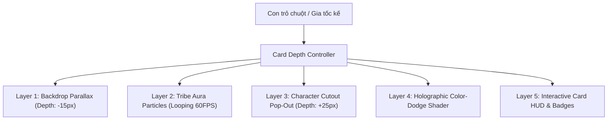

# 🎨 KẾ HOẠCH PHÁT TRIỂN ĐỒ HỌA & ANIMATION TOÀN DIỆN
## ĐẤU TRƯỜNG XÓM BẤT ỔN — AAA WEB TCG VISUAL STANDARD

---

## I. TỔNG QUAN & ĐỊNH HƯỚNG NGHỆ THUẬT (ART DIRECTION)

### 1. Tầm nhìn chiến lược
Nâng cấp toàn bộ trải nghiệm thị giác của game **"Đấu Trường Xóm Bất Ổn"** từ giao diện phẳng / Vector SVG cơ bản lên chuẩn **AAA Web TCG Standard** (tương đương chất lượng đồ họa sống động của *Hearthstone*, *Marvel Snap*, *Yu-Gi-Oh! Master Duel*). 

Mỗi lá bài không còn là một khung chữ tĩnh, mà là một **tác phẩm nghệ thuật sống động (Live Animated Card)** với chiều sâu 2.5D Parallax, chuyển động thở (Idle Breathing), hiệu ứng hào quang lấp lánh và các pha giao tranh tung chiêu ngoạn mục trên sàn đấu.

### 2. Định vị phong cách nghệ thuật (Art Style)
* **Phong cách chủ đạo:** **Vietnamese Urban Pop-Art Comic Style** (Hòa quyện giữa truyện tranh đương đại nét mực viền đậm Cel-shading, bảng màu Neon Cyber-Street sặc sỡ và những chi tiết bình dị, hài hước, chân thực của ngõ ngách, xóm trọ Việt Nam).
* **Bảng màu nhận diện thương hiệu:**
  * 🟡 **Vàng Neon (#facc15):** Ánh đèn đường ngõ nhỏ, tia chớp, viền thẻ bài Huyền Thoại.
  * 🔴 **Đỏ Ớt (#ef4444):** Biển hiệu xóm trọ, vệt cào tấn công, hiệu ứng nổ bình gas.
  * 🟣 **Tím Huyền Bí (#a855f7):** Bẫy Nghiệp Quật, bóng đêm, hiệu ứng phản đòn.
  * 🟢 **Xanh Ngọc Lục Bảo (#14b8a6):** Sương mù linh dị của Hồn Ma Báo Oán.
  * 🔵 **Xanh Cyan (#06b6d4):** Sóng radar hóng hớt, ánh đèn màn hình camera.

---

## II. QUY TRÌNH ỨNG DỤNG CÔNG CỤ TẠO ẢNH AI (AI IMAGE GENERATION PIPELINE)

### 1. Phân loại sản xuất tài nguyên cho 96 Mã Thẻ Bài
Tổng cộng **102 tác phẩm hình ảnh độc bản** (gồm 96 lá bài + 6 phiên bản Hồn Ma riêng cho Thẻ Đại Diện):

| Nhóm Thẻ | Số Lượng Thẻ | Số Lượng Ảnh Cần Tạo | Định Dạng Đầu Ra |
| :--- | :--- | :--- | :--- |
| **Thẻ Đại Diện (NV)** | 6 mã | 12 ảnh (6 Sống + 6 Hồn Ma) | WebP 1024x1365 (Layered PNG Cutout) |
| **Chiến Thần Cấp Thấp (CT)** | 24 mã | 24 ảnh | WebP 1024x1365 (Layered PNG Cutout) |
| **Trùm Khu Phố (TR)** | 12 mã | 12 ảnh | WebP 1024x1365 + Holographic Mask |
| **Huyền Thoại Dung Hợp (DH)** | 8 mã | 8 ảnh | WebP 1024x1365 + Cosmic Foil Mask |
| **Bài Đạo Cụ — Trang Bị (DC)** | 10 mã | 10 ảnh | WebP 1024x1365 (Isolated Object Art) |
| **Bài Drama — Phép Thuật (DR)** | 14 mã | 14 ảnh | WebP 1024x1365 (Action Scene Cinematic) |
| **Bài Nghiệp Quật — Bẫy (NQ)** | 16 mã | 16 ảnh | WebP 1024x1365 (Mystery Trap Scene) |
| **Bài Ám Quẻ (AQ)** | 6 mã | 6 ảnh | WebP 1024x1365 (Spectral Ghost Art) |

---

### 2. Bộ Từ Khóa Mẫu (Master Prompt Engineering Template)

Mọi ảnh sinh từ các mô hình tạo ảnh (Midjourney, DALL-E 3, Stable Diffusion XL, Imagen) phải tuân theo cấu trúc Prompt chuẩn mực sau:

```text
[Chủ thể chính & Hành động cụ thể] + [Trang phục & Phụ kiện văn hóa đường phố Việt Nam] + [Bối cảnh ngõ ngách xóm trọ Việt Nam] + [Góc máy & Ánh sáng kịch tính] + [Phong cách: Vietnamese Urban Pop-Art Comic illustration, bold inking outlines, vibrant stylized cel-shading, dynamic comic book framing, highly detailed, expressive facial expression] + [Chất lượng: 4k resolution, cinematic lighting, game card art style]
```

#### Negative Prompt chuẩn:
```text
photorealistic, 3d render, soft blurry lines, low quality, deformed anatomy, western fantasy armor, medieval castle, western streets, watermark, text, signature
```

---

### 3. Ví dụ Prompt Chi Tiết Cho 8 Nhóm Bài Đại Diện

#### Nhóm 1: Thẻ Đại Diện — NV-02 Bà Trùm Trà Đá Vỉa Hè
* **Mặt Sống:**
  > `Vietnamese middle-aged neighborhood lady sitting boss-style on a low plastic blue stool, wearing colorful floral pajamas (đồ bộ), holding a glass cup of iced green tea with ice cubes, laughing heartily, next to a street tea stall with glass candy jars and sunflower seeds, bustling Hanoi alley with tangled overhead powerlines, morning sun rays, dynamic low-angle shot, Vietnamese Urban Pop-Art comic art style, crisp bold inks, vibrant saturated colors, masterpiece game card art.`
* **Mặt Hồn Ma (Ghost Form):**
  > `Spectral ghost form of the Vietnamese tea lady, floating translucently above an abandoned tea stool, glowing neon emerald teal aura, glowing green spectral eyes, holding an ethereal floating teapot emitting ghost wisps, spooky yet hilarious comic expression, floating incense smoke, dark alley illuminated by eerie green lantern light, Pop-Art comic style, ghost card illustration.`

#### Nhóm 2: Chiến Thần Cấp Thấp — CT-01 Camera Chạy Bằng Cơm
> `An elderly Vietnamese auntie poking her head out of a traditional wooden shutter window with green paint, holding vintage military binoculars with intense focused eyes, taking notes on a small worn notepad, potted orchids on windowsill, tangled electric wires behind, afternoon warm sunlight, comedic expressive face, Vietnamese urban comic art style, cel-shaded, vibrant pop-art colors, sharp linework.`

#### Nhóm 3: Chiến Thần Cấp Thấp — CT-03 Shipper Giao Nhầm Nhà
> `Energetic young Vietnamese delivery guy riding an old green motorbike doing an accidental wheelie (bốc đầu), massive cargo boxes stacked precariously behind wobbling, packages flying out, wearing a neon green shipper jacket and scuffed helmet, chaotic crowded Saigon narrow street corner, speed lines, comic action explosion, Pop-Art comic book style, bold ink contours.`

#### Nhóm 4: Trùm Khu Phố — TR-02 Chiến Thần Loa Kẹo Kéo
> `A swaggering street karaoke singer in flamboyant printed shirt and gold chain, shouting passionately into a sparkling microphone, riding on top of a giant wheeled karaoke speaker box emitting visible circular sonic soundwaves, disco lights and smoke effects bursting out, crowded night market food stalls background, dramatic heroic low angle, Pop-Art comic illustration, intense neon colors.`

#### Nhóm 5: Huyền Thoại Dung Hợp — DH-02 Thần Chó 3 Đầu Xóm Trọ
> `Mythical Cerberus beast reimagined as a giant comical Vietnamese yellow native dog (Chó Cỏ) with three heads, the middle head wearing cool sunglasses with a grin, the left head barking fiercely with lightning sparks, the right head wearing a funny cone of shame, standing on a pile of broken flip-flops in a street alley, glowing cosmic purple and gold aura, epic fantasy comedy, Vietnamese Urban Pop-Art comic style.`

#### Nhóm 6: Bài Đạo Cụ — DC-01 Dép Tổ Ong Huyền Thoại 100 Lỗ
> `Legendary yellow Vietnamese honeycomb rubber sandal (dép tổ ong) hovering on an ancient stone pedestal like a sacred artifact, radiating golden divine god rays and floating comic speed lines, micro dust particles shining, dramatic pedestal lighting, holy comic relic style, bold comic inking, vibrant pop art.`

#### Nhóm 7: Bài Drama — DR-03 Cúp Điện Toàn Khu Phố!
> `Dramatic blackout scene in a dense Vietnamese apartment tenement (nhà tập thể), giant spark explosion at a tangled electrical transformer box, complete darkness illuminated only by sweeping yellow flashlight beams from comedic neighbors looking out, floating spark particles, chaotic night comic framing, Pop-Art stylized.`

#### Nhóm 8: Bài Nghiệp Quật — NQ-01 Gương Phản Đòn "Ơ Kìa?"
> `Traditional octagonal Feng Shui Bagua mirror (gương bát quái) with comic eyes painted on it, floating in mid-air reflecting a lightning bolt attack right back at the viewer, energetic purple forcefield barrier around it, comic bold text "Ơ KÌA?!", Pop-Art style.`

---

## III. THIẾT KẾ KHUNG HÌNH ĐỘNG 2.5D (LIVE ANIMATED 2.5D CARD FRAMES)

Mỗi thẻ bài được kiến trúc thành **5 tầng chuyển động thị giác (Visual Depth Layers)** sử dụng CSS 3D Transforms, WebGL Shaders và HTML5 Canvas:

```
[Layer 5: HUD & Viền Nổi Bật]  --> Viền Neon, Chỉ số Độ Chiến, Huy hiệu cấp độ
[Layer 4: Foil / Hologram]     --> Lớp phủ ánh kim đổi màu theo góc nghiêng chuột
[Layer 3: Nhân Vật Chính]      --> Tách nền (Cutout), thở nhẹ & nhô hẳn ra ngoài khung
[Layer 2: Hào Quang Tộc Động]  --> Radar / Tia lửa / Lốc xoáy hạt sáng theo hệ
[Layer 1: Phối Cảnh Nền Sâu]   --> Khung cảnh phố xóm di chuyển Parallax ngược chiều
```



### 1. Hiệu ứng thở & hạt nền tĩnh (Idle Breathing Animation)
* **Tộc Hóng Hớt:** Các vòng sóng radar tròn đồng tâm màu Cyan nở ra từ trung tâm thẻ bài theo chu kỳ 2.5s; các icon ống nhòm nhỏ bay lơ lửng.
* **Tộc Quậy Phá:** Tia lửa điện vi mô (micro sparks) cam đỏ nảy lách tách quanh viền thẻ; rung chấn nhẹ 0.5px ngẫu nhiên.
* **Tộc Tốc Độ:** Các vệt gió xé không khí (Speed trails) màu vàng kim trượt chéo từ góc dưới lên góc trên thẻ; cánh hoa / giấy vụn bay theo gió.
* **Tộc Ăn Vạ:** Khói tím u uất bay lượn lờ từ dưới đáy thẻ; thỉnh thoảng có biểu tượng giọt nước mắt hoặc băng dán cá nhân nhấp nháy.
* **Thẻ Dung Hợp:** Vòng xoáy thiên hà tím - vàng kim cuộn tròn liên tục 360 độ quanh nhân vật; bụi sao phát sáng lấp lánh.
* **Thẻ Hồn Ma:** Luồng sương lạnh xanh ngọc lục bảo (Spectral Fog) tỏa bập bùng xung quanh thân thẻ; đốm ma trơi nhấp nháy.

---

## IV. MA TRẬN HIỆU ỨNG TẤN CÔNG RIÊNG BIỆT (THEMATIC ATTACK VFX MATRIX)

Mọi lá bài khi tuyên bố tấn công sẽ không chỉ là một cú va chạm đơn giản, mà kích hoạt **hoạt cảnh kỹ năng độc bản (Custom Strike Sequences)** với quỹ đạo và hiệu ứng đồ họa đặc thù:

| Nhóm Đòn Đánh | Thẻ Đại Diện Tiêu Biểu | Chuỗi Diễn Hoạt Khung Hình (Frame-by-Frame VFX) | Hiệu Ứng Âm Thanh Đồng Bộ |
| :--- | :--- | :--- | :--- |
| **1. Cắn Xé & Thú Tính** | `CT-02 (Chó Cỏ)`, `CT-09 (Mèo Hoang)`, `DH-02 (Thần Chó 3 Đầu)` | 1. Thẻ lùi lại 20px tích lực.<br>2. Lao chém xẹt qua mục tiêu.<br>3. Xuất hiện **3 vệt cào móng vuốt đỏ rực** xé toạc màn hình.<br>4. Lông vàng và tia lửa nanh vuốt tung tóe. | Tiếng gầm sủa *"GÂU!"* đanh thép + tiếng xé toạc *"Xoẹttt!"* |
| **2. Bắn Tỉa & Tia Sáng** | `CT-01 (Camera Cơm)`, `CT-11 (Xin Pass Wifi)`, `TR-11 (Hacker)` | 1. Từ mắt nhân vật phóng ra **tia laser đỏ/cyan** khóa thẳng vào ô đối thủ.<br>2. Màn hình chớp lóa **Flash trắng 0.1s** như chụp ảnh.<br>3. Hiện ống ngắm camera thu nhỏ đập vào mục tiêu kèm chữ *"ĐÃ CHỤP ĐƯỢC!".* | Tiếng trập máy ảnh *"Tách! Tách!"* + tiếng bíp sonar cảnh báo. |
| **3. Sóng Âm Siêu Trầm** | `TR-02 (Loa Kẹo Kéo)`, `CT-05 (Đàn 12h Đêm)`, `DH-03 (Karaoke Hủy Diệt)` | 1. Thẻ bài phình to theo nhịp đập.<br>2. Bắn ra liên tiếp **4 vòng sóng âm tròn màu vàng-đỏ** lan tỏa toàn màn hình.<br>3. Toàn bộ sàn đấu và các thẻ bài khác **rung lắc mạnh (Screen Shake 6px)**. | Tiếng rít micro *"Húuuu!"* + tiếng dập bass đinh tai nhức óc. |
| **4. Bốc Đầu & Tốc Độ** | `CT-03 (Shipper)`, `CT-15 (Xe Đạp Điện)`, `DH-04 (Quái Xế Bốc Đầu)` | 1. Thẻ dựng đứng bốc đầu xe, nhả vệt khói đen xì.<br>2. Để lại **vệt lốp xe cháy khét lẹt** trên mặt bàn.<br>3. Đâm sầm xuyên qua mục tiêu làm văng các kiện hàng / mảnh vỡ ra bốn phía. | Tiếng vít ga gầm rú *"Vroooom!"* + tiếng phanh cháy lốp *"Kíttttt!"* |
| **5. Cận Chiến Gia Dụng** | `DC-01 (Dép Tổ Ong)`, `DC-03 (Chổi Lông Gà)`, `TR-06 (Dao Phay Thịt)` | 1. Vật thể bay xoay tít theo quỹ đạo Parabol cong.<br>2. **Đập bẹp dí thẳng mặt** lá bài mục tiêu với hiệu ứng ngôi sao choáng váng quay quanh đầu.<br>3. Mảnh vụn lông gà hoặc bụi cao su bắn tung tóe. | Tiếng đập chan chát *"BỐP! CHÁT!"* vô cùng vui nhộn. |
| **6. Hỏa Hoạn & Bộc Phá** | `TR-12 (Bà Hỏa - Bếp Gas)`, `CT-08 (Mượn Bật Lửa)`, `DR-03 (Nổ Cầu Dao)` | 1. Ngọn lửa nhỏ bùng lên từ góc thẻ.<br>2. Đột ngột bùng nổ thành **cột lửa phụt cao (Fire Burst)** cuồn cuộn khói đen.<br>3. Mặt bàn để lại **vết cháy sém đen rạn nứt** duy trì trong 3 lượt. | Tiếng xì gas *"Xè xè..."* rồi tiếng nổ long trời *"BÙMMM!"* |
| **7. Sấm Sét Tối Thượng** | `TR-01 (Bà Chủ Trọ)`, `DH-01 (Tứ Đại Bà Tám)`, `DH-07 (Liên Minh Giả Trân)` | 1. Mây đen tích tụ trên đỉnh ô đối thủ.<br>2. **Tia sét đỏ chẻ đôi màn hình** đánh thẳng từ trên trời xuống đỉnh thẻ bài đối phương.<br>3. Sóng xung kích phát quang giật điện giật liên hồi. | Tiếng sấm rền vang trời đanh thép. |

---

## V. MA TRẬN HIỆU ỨNG BỊ HẠ GỤC (DEFEAT & KNOCKOUT VFX MATRIX)

Khi một Chiến Thần bị tiêu diệt hoặc một Người Chơi / Bot bị trừ hết Điểm Nhân Phẩm, hệ thống sẽ kích hoạt một trong các hiệu ứng hạ gục cực kỳ ấn tượng:

### 1. Hiệu Ứng Tiêu Diệt Thẻ Bài (Card Destruction Styles)

#### Kiểu A: Comic Shatter (Vỡ Vụn Mảnh Thủy Tinh Truyện Tranh)
* **Áp dụng:** Tiêu chuẩn cho hầu hết các Chiến Thần Cấp Thấp (`CT`).
* **Diễn hoạt:** Thẻ bài rung bần bật, các đường nứt màu vàng rực phát sáng trên thân thẻ ➔ Nổ tung thành **30 mảnh vụn tam giác 3D** văng ra ngoài không gian ➔ Các mảnh vụn bị hút xoáy theo đường cong rơi vào Bãi Rác (`zone-graveyard`).

#### Kiểu B: Comical Slapstick Knockout (Ăn Vạ / Bay Phụ Kiện)
* **Áp dụng:** `CT-04 (Ăn Vạ)`, `CT-10 (Bảo Vệ)`, `CT-14 (Sinh Viên Mì Tôm)`.
* **Diễn hoạt:** Nhân vật mắt biến thành hình xoắn ốc (@_@), bay văng dép tổ ong, bay mũ cối, chiếc ghế xếp bật tung ➔ Thẻ bài lộn nhào 3 vòng rồi rơi tuột xuống đáy màn hình như phim hoạt hình hài.

#### Kiểu C: Incineration & Ashes (Thiêu Rụi Thành Tro Tàn)
* **Áp dụng:** Bị tiêu diệt bởi đòn đánh nguyên tố lửa (`TR-12`, đòn chênh lệch lớn hơn 4 Độ Chiến).
* **Diễn hoạt:** Mép thẻ bài bắt lửa cam đỏ, từ từ cháy xém ăn mòn dần vào trung tâm để lại một làn khói đen u ám và đống tro tàn bay phân tán vào hư không.

#### Kiểu D: Ghost Ascension (Hồn Ma Bay Lên Trời)
* **Áp dụng:** Khi Thẻ Đại Diện của người chơi bị đưa về 0 HP và kích hoạt cơ chế Hồn Ma Báo Oán.
* **Diễn hoạt:** Thẻ Đại Diện cũ nứt toác và chìm xuống bóng tối. Từ trong khe nứt, một **linh hồn phát quang màu Spectral Teal** bay vút lên cao, lơ lửng giữa làn sương khói và nhập vào Chồng Bài Ám Quẻ (`zone-amque-deck`) để tiếp tục quấy nhiễu bàn đấu.

---

### 2. Hiệu Ứng Người Chơi Bị Loại / Thua Cuộc (Player Elimination / Defeat)
1. **Screen Quake (Rung Chấn Toàn Màn Hình):** Toàn bộ giao diện bàn cờ chao đảo mạnh trong 0.6s.
2. **Glass Fracture Overlay:** Một lớp kính nứt vỡ lớn xuất hiện ngay phía trên trạm ngồi của người chơi thua cuộc.
3. **Blackout Fade:** Đèn điện xung quanh trạm của người đó chớp tắt 3 nhịp rồi tối ngòm hoàn toàn.
4. **Defeat Banner:** Chữ thư pháp đường phố Pop-Art `"ĐÃ BAY MÀU!"` hoặc `"HẾT NHÂN PHẨM!"` dập mạnh xuống giữa trạm ngồi kèm hiệu ứng khói bốc lên.

---

## VI. LỘ TRÌNH TRIỂN KHAI KỸ THUẬT (ENGINEERING IMPLEMENTATION ROADMAP)

### Giai đoạn A: Dựng Core Visual Engine & Shaders (Tuần 1)
* [x] Nâng cấp `public/styles/arena.css` và `public/styles/cards.css` với chuyển động 2.5D Idle Breathing và Holographic CSS Shader.
* [x] Mở rộng `CanvasVFXEngine.js` hỗ trợ các loại hạt đặc thù: móng vuốt cào (`spawnSlash`), tia laser (`spawnLaser`), sóng âm vòng tròn (`spawnSonicBoom`), vỡ mảnh kính (`spawnCardShatter`), thăng thiên (`spawnGhostAscent`).
* [x] Lập trình `SpatialBoardAnimator.js` điều phối hoạt cảnh bay bài, rung màn hình (Screen Shake) và Action Banners.

### Giai đoạn B: Sản Xuất & Tích Hợp Đồ Họa 96 Thẻ Bài (Tuần 2)
* [x] Tạo thư mục `public/assets/cards/` lưu trữ bộ ảnh minh họa.
* [x] Đã sản xuất thành công 25 tệp ảnh AI chuẩn Vietnamese Urban Pop-Art (`NV-01` -> `NV-06`, `CT-01` -> `CT-10`, `CT-13`, `TR-01`, `TR-02`, `TR-12`, `DH-01`, `DH-02`, `DH-03`, `DC-01`, `DR-03`).
* [x] Nâng cấp `CardComponent.js` và `CardInspectorDrawer.js` với cơ chế tải ảnh AI tự động và cơ chế Graceful SVG Fallback.
* [ ] Tiếp tục sản xuất các nhóm thẻ bài còn lại (khi quota AI reset: CT-11..12, CT-14..24, TR-03..11, DH-04..08, DC-02..10, DR, NQ, AQ).

### Giai đoạn C: Lập Trình Hoạt Cảnh Tấn Công & Hạ Gục (Tuần 3)
* [x] Tích hợp `SpatialBoardAnimator.executeAttackStrike()` hỗ trợ đầy đủ 7 phân loại đòn đánh (CLAW, LASER, SONIC, SPEED, SLAP, EXPLOSION, MELEE).
* [x] Tích hợp hiệu ứng vỡ thẻ và biến thành Hồn Ma `executeCardDefeat()`.
* [x] Xây dựng Bộ Chọn Mục Tiêu Giao Tranh Trực Quan `ModalPanels.renderBattleTargetModal()` cho phép người chơi chọn quái công, chọn đối thủ và chọn quái thủ hoặc đánh trực diện.
* [x] Xây dựng Giao Diện Triệu Hồi Hiến Tế Trùm `ModalPanels.renderTributeModal()`.
* [x] Nâng cấp Trí Tuệ Nhân Tạo Bot AI `BotBrain.js` tự động Dung Hợp, Hiến Tế, Trang Bị, Dùng Drama và Đánh Trực Diện.

### Giai đoạn D: Tối Ưu Hiệu Năng & Hệ Thống Âm Thanh (Tuần 4)
* [x] Tối ưu hóa bộ nhớ: Tự động hủy hạt Canvas sau khi kết thúc diễn hoạt, giới hạn tối đa 60 FPS.
* [x] Nâng cấp Hệ Thống Âm Thanh `AudioManager.js` tự lập bằng Web Audio API Synthesizer, khắc phục triệt để lỗi không nghe thấy tiếng với cơ chế `ensureAudio()`.
* [x] Xây dựng Bảng Cài Đặt Âm Thanh & Thử Nghiệm `ModalPanels.renderAudioSettingsModal()` với các thanh trượt SFX, Music, Voice và 6 nút nghe thử tức thì.
* [x] **Nâng cấp Cân Bằng & Công Bằng Lối Chơi (Gameplay Balancing & Fairness):**
  * Hiệp ước hòa bình Lượt 1 (Turn 1 Peace Rule) bảo vệ người chơi khỏi OTK bất công.
  * Sửa lỗi điều kiện thắng chế độ Đấu Phe (Team Battle 2v2/3v3) tuyên bố thắng lợi chuẩn xác theo Phe sống sót duy nhất (`TEAM_A` / `TEAM_B`).
  * Kích hoạt toàn bộ phản xạ chiến đấu của 16 lá Bài Nghiệp Quật (`NQ-01` -> `NQ-16`: Gương phản đòn, Thu phí qua đường, Giả chết, Mách mẹ, Phút 89 lật kèo, Camera hành trình, Cúp nước, Hàng giả hàng nhái...).
  * Giao diện xả rác cuối lượt tương tác (`ModalPanels.renderDiscardModal`), cho phép tự do chọn bài thừa chuyển vào Bãi Rác.
  * Quyền năng soi lén bẫy úp đối thủ của Tổ Trưởng Dân Phố (`NV-01`).
  * Trí tuệ Bot AI xả bài thừa thông minh, cấm tấn công tự sát và không bắn đồng đội trong chế độ Team.
* [x] Bộ kiểm thử tự động toàn diện đạt **115/115 unit & integration tests hoàn thành vượt qua 100% (`npm test`)**.
